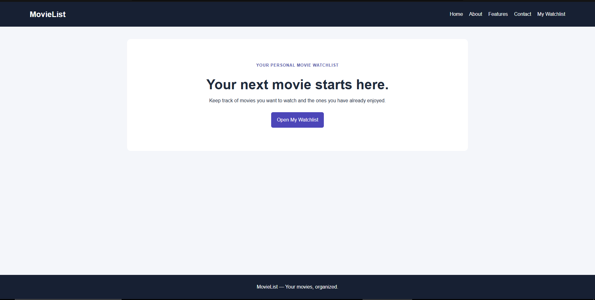
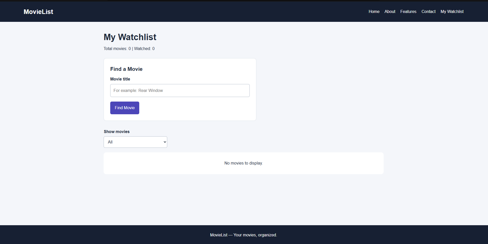
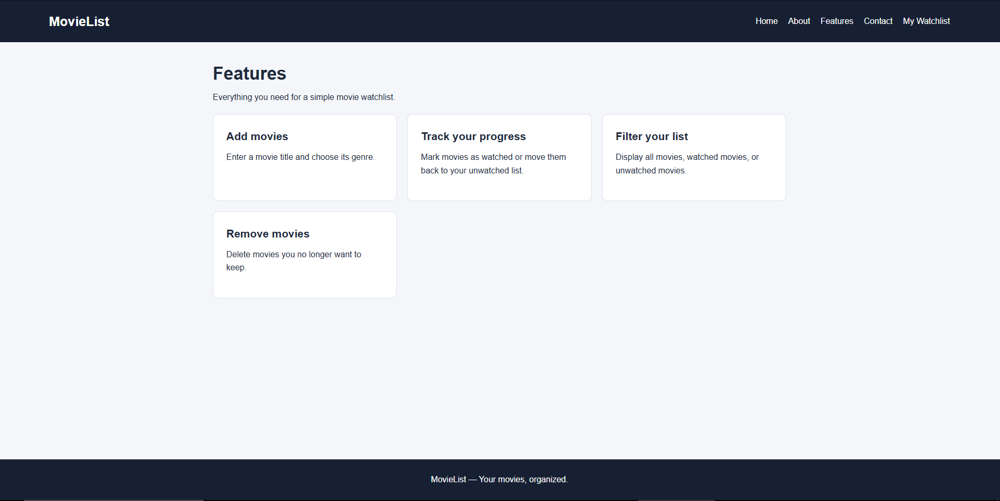
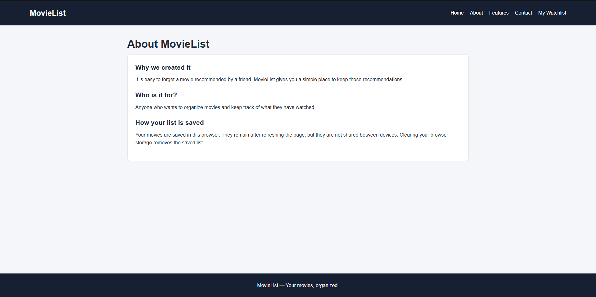
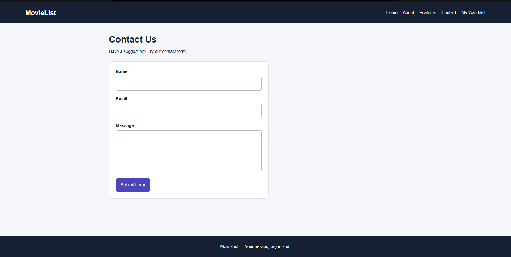

🔗 **Live Demo:** [https://your-vercel-url.vercel.app](https://your-vercel-url.vercel.app)

# Movie Watchlist

A web application built using React and Vite for our Advanced Web Programming course. This project allows users to search for movies using the OMDb API and build a personal watchlist.

Created by **Adam Trawi** and **Abed Balhawan**.

---

## 📌 Project Description

MovieList is a simple single-page app where users can look up movies, view details like release year and IMDb ratings, and save them to their watchlist. 

Key features include:
* Search for movies via the OMDb API
* Add and delete movies from your watchlist
* Toggle movies between "Watched" and "Unwatched"
* Filter list view by Watched or Unwatched status
* Local storage support (movies stay saved after refreshing the page)

---

## 📸 Screenshots

### Home Page


### Watchlist & Search Page


### Features Page


### About Page


### Contact Page


---

## 🛠️ Built With

* React
* Vite
* React Router DOM
* OMDb API
* CSS

---

## 🚀 How to Run the Project Locally

### Prerequisites
Make sure you have [Node.js](https://nodejs.org/) installed on your computer.

### Steps

1. **Clone the repository:**
   ```bash
   git clone [https://github.com/adamtrawi/movie-watchlist.git](https://github.com/adamtrawi/movie-watchlist.git)
   cd movie-watchlist